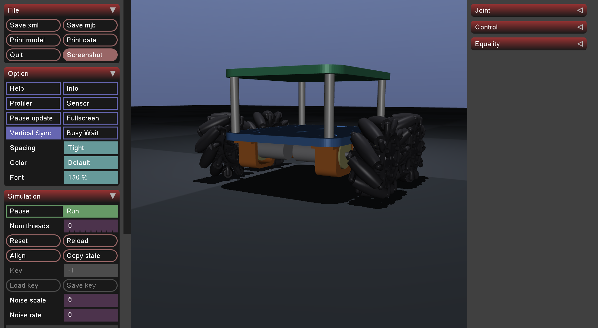

# autonomous-rover-mujoco

A 4-wheel **mecanum rover** simulated in [MuJoCo](https://mujoco.org), built from my own CAD (Onshape → STL).
The long-term goal is an autonomous rover for **uneven-terrain navigation and environment monitoring**, with
wheel odometry, onboard sensing and a path from simulation to the real hardware.

<<<<<<< HEAD

=======

>>>>>>> 9c1a8bf67866f625c3e132faad3dd72122015a60

---

## Status

| Area | State |
|------|-------|
| Chassis, motor holders, 4 geared motors, 4 mecanum wheels (from CAD) | Done |
| Holonomic drive: forward, strafe, rotate, curves (keyboard + scripted demo) | Done, tested |
| Wheel odometry | Planned |
| IMU and environment sensors (temperature, humidity, gas) | Planned |
| Uneven terrain (heightfield) | Planned |
| Autonomous navigation | Planned |

Mecanum rollers are small and can slip on bumps, so rough-terrain performance is something I still need to
measure in simulation. It is not claimed yet.

---

## Quick start

```bash
git clone https://github.com/yukti-m20/autonomous-rover-mujoco.git
cd autonomous-rover-mujoco
pip install -r requirements.txt

python3 view.py               # just look at the model
python3 drive_demo.py         # drive it with the keyboard
python3 drive_demo.py --auto  # scripted demo
```

### Controls (`drive_demo.py`)

| Key | Action |
|-----|--------|
| `W` / `S` | forward / backward |
| `A` / `D` | strafe left / right (the body keeps facing forward) |
| `Q` / `E` | rotate left / right in place |
| `+` / `-` | speed up / slow down |
| `SPACE` | stop |

Commands latch: the robot keeps moving until you press `SPACE` or another key.

---

## Folder layout

```
autonomous-rover-mujoco/
├── README.md
├── requirements.txt
├── .gitignore
├── view.py                 # open the model in the MuJoCo viewer
├── drive_demo.py           # keyboard / scripted driving with mecanum inverse kinematics
├── models/
│   ├── robot.xml           # MJCF model: chassis, motors, wheels, actuators
│   └── meshes/             # STL files exported from CAD
│       ├── lower_base.stl
│       ├── upper_base.stl
│       ├── bar_link.stl
│       ├── motor_holder.stl
│       ├── Left_wheel.stl
│       └── Right_wheel.stl
└── docs/
    └── images/             # screenshots and GIFs used in this README
        └── rover_sim.png
```

---

## Robot model

- **Chassis:** two 210 × 175 × 10 mm plates joined by four 75 mm standoffs.
- **Drive:** 4 × 12 V geared DC motors (200 rpm), each clamped in a 3D-printed holder under the lower plate.
- **Wheels:** 100 mm mecanum wheels, 10 rollers each at 45°. `Left_wheel` goes on front-left and rear-right,
  `Right_wheel` on front-right and rear-left (X pattern).
- **Wheel physics:** MuJoCo has no directional friction, so each wheel carries 10 hinged roller bodies with the
  roller axes at 45°. The wheel STL is drawn on top for appearance.
- **Motors:** velocity actuators that behave like a DC motor (torque ∝ speed error, capped at stall torque).
  Top speed is about 1.05 m/s at 200 rpm.

> Placeholders to update from datasheets: motor stall torque (0.6 N·m), payload mass (battery, electronics).

### How the wheels move the robot

For wheel `i` at position `(xi, yi)` from the robot centre, with roller handedness `h = ±1`:

```
wheel_speed_i = ( vx + h·vy + ( -yi + h·xi ) · ωz ) / R
```

`vx` is forward, `vy` is left, `ωz` is counter-clockwise rotation and `R` is the wheel radius. This is what
`drive_demo.py` uses. I checked it against the simulation: strafing gives pure sideways motion, and the rotation
command turns the body in place.

---

## Roadmap

- [ ] Wheel odometry from joint velocities and the mecanum forward kinematics
- [ ] IMU (gyro + accelerometer) and odometry/IMU fusion
- [ ] Bumpy terrain with a heightfield, and a slip/traction study
- [ ] Simulated environment sensors (temperature, humidity, gas) with a logging pipeline
- [ ] Waypoint navigation and obstacle avoidance
- [ ] ROS 2 bridge, then deployment on the real rover (Raspberry Pi 5 + ESP32)

---

## Adding screenshots

Put images in `docs/images/` and reference them with a relative path:

```markdown

```

A screenshot of the viewer (or a short GIF of the `--auto` demo) near the top of this README makes the project
easy to understand at a glance.

---

## Requirements

- Python 3.9+
- `mujoco`, `numpy` (see `requirements.txt`)

## License

<<<<<<< HEAD
MIT (add a `LICENSE` file when you publish).
=======
MIT (add a `LICENSE` file when you publish).
>>>>>>> 9c1a8bf67866f625c3e132faad3dd72122015a60
